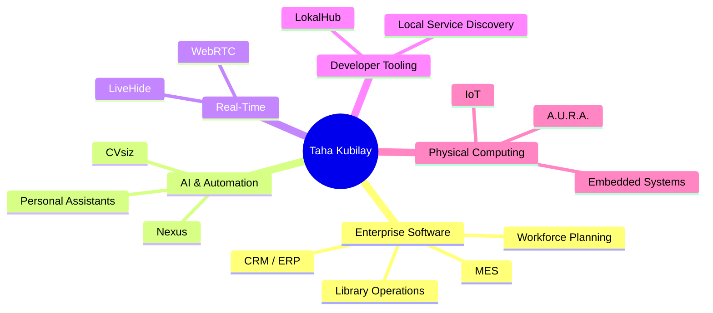

# Hi, I'm Taha Kubilay 👋

### Software Engineer · Full-Stack Systems · Enterprise Software · AI & Automation

 

---

## 👨‍💻 About Me

I build software around **real operational problems** — systems with workflows, constraints, integrations, data and users that need to work together reliably.

My projects range from enterprise management platforms and workforce scheduling to real-time communication, self-hosted AI systems, developer tooling and experimental physical AI.

I enjoy working across the full product lifecycle:

`Requirements` → `Architecture` → `Backend` → `Frontend` → `Integrations` → `Deployment`

> [!TIP]
> The repositories below are being prepared as **engineering case studies**. Each project will progressively include screenshots, technical architecture, setup instructions, demo environments and full code-derived documentation.

---

# 🚀 Featured Engineering Work

<table>
<tr>
<td width="50%" valign="top">

### 🗓️ [Shift Planning System](https://github.com/tahakubilay/shift-planning-system)

Rule-driven workforce scheduling and operations platform designed around complex personnel constraints, planning workflows and analytics.

**Focus:**  
`Business Rules` `Scheduling` `Enterprise Software`

</td>
<td width="50%" valign="top">

### 🏢 [Enterprise CRM & ERP](https://github.com/tahakubilay/enterprise-crm-erp)

Integrated business platform connecting customer operations, internal workflows, reporting and enterprise processes.

**Focus:**  
`CRM` `ERP` `Workflow Architecture`

</td>
</tr>

<tr>
<td width="50%" valign="top">

### 🎥 [LiveHide](https://github.com/tahakubilay/LiveHide)

Privacy-focused real-time communication project centered around peer-to-peer video and audio interaction.

**Focus:**  
`WebRTC` `Real-Time Systems` `Networking`

</td>
<td width="50%" valign="top">

### 🤖 [Nexus](https://github.com/tahakubilay/Nexus)

Self-hosted personal AI and life-management platform combining assistants, automation, integrations and personal workflows.

**Focus:**  
`AI Systems` `Automation` `Self-Hosting`

</td>
</tr>

<tr>
<td width="50%" valign="top">

### 🔮 [A.U.R.A.](https://github.com/tahakubilay/Aura)

Experimental physical AI assistant combining magnetic levitation, wireless power, directional audio sensing and expressive interaction.

**Focus:**  
`Physical AI` `Embedded Systems` `IoT`

</td>
<td width="50%" valign="top">

### 🧭 [LokalHub](https://github.com/tahakubilay/LokalHub)

Developer dashboard for discovering local services, open ports, APIs, processes and Docker workloads across multiple projects.

**Focus:**  
`Developer Tooling` `Service Discovery` `Docker`

</td>
</tr>
</table>

---

## 🧩 More Projects

| Project | What it explores |
|---|---|
| ⚙️ **[MES Management Platform](https://github.com/tahakubilay/mes-management-platform)** | Operational workflows, administration, tracking and business reporting |
| 📚 **[Library Management System](https://github.com/tahakubilay/library-management-system)** | Catalog, inventory, circulation and administrative workflows |
| 📱 **CVsiz** | Mobile recruitment platform combining AI-assisted job discovery, candidate/employer flows and voice-oriented interaction — **public portfolio release in preparation** |

---

# 🧠 Engineering Focus

<table>
<tr>
<td valign="top">

### ⚙️ Backend & APIs
- Application architecture
- REST APIs
- Authentication & authorization
- Business logic
- Service integrations

</td>
<td valign="top">

### 🖥️ Product Engineering
- Full-stack applications
- Operational dashboards
- Administrative interfaces
- End-to-end workflows
- Product-oriented development

</td>
</tr>
<tr>
<td valign="top">

### 🏢 Enterprise Systems
- CRM / ERP
- Workforce management
- Inventory systems
- Workflow modelling
- Reporting & analytics

</td>
<td valign="top">

### 🤖 AI & Automation
- AI assistants
- Conversational experiences
- Automation workflows
- Personal AI systems
- Applied AI integrations

</td>
</tr>
<tr>
<td valign="top">

### 🌐 Real-Time Systems
- WebRTC
- Peer-to-peer communication
- Event-driven state
- Network-aware UX

</td>
<td valign="top">

### 🔬 Experimental Engineering
- Embedded systems
- IoT
- Physical AI
- Hardware/software integration
- Human-computer interaction

</td>
</tr>
</table>

---

## 🗺️ Portfolio Map

---

## 🛠️ Portfolio Build Status

- [x] GitHub profile structure
- [x] Public project repositories
- [x] Recruiter-facing project overviews
- [x] Visual README standard
- [ ] Final source-code cleanup
- [ ] Full technical documentation
- [ ] Architecture & database diagrams
- [ ] Real screenshots and product GIFs
- [ ] Installation guides
- [ ] Public demo environments
- [ ] Release builds / APKs where applicable

### Building software that turns complex workflows into usable products.

[Explore my repositories](https://github.com/tahakubilay?tab=repositories)

